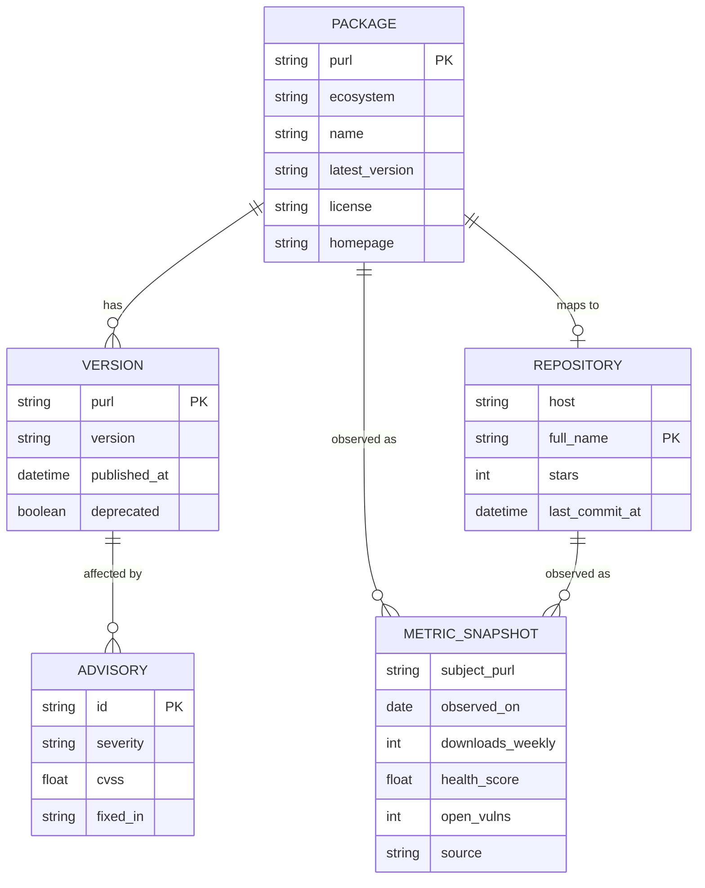
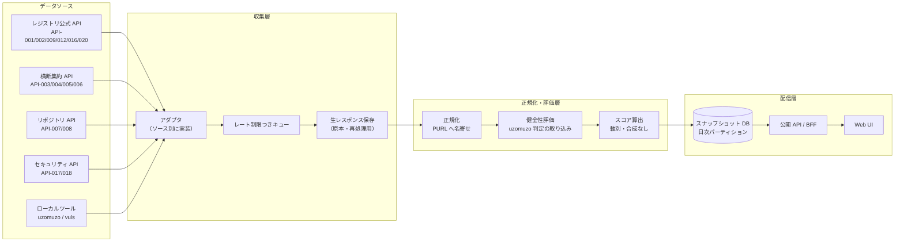
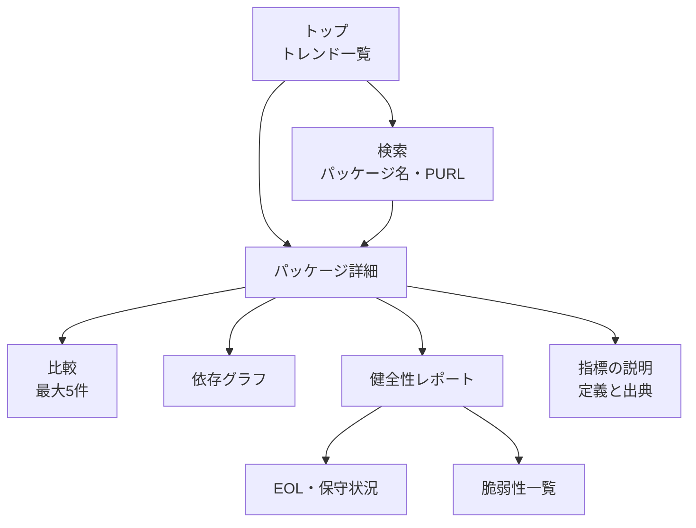

# libtrends 設計たたき台

> 索引: [README.md](README.md) ／ 前提となる API 調査: [01-apis.md](01-apis.md)

## 概要

### 目的

libtrends は、言語とレジストリをまたいでライブラリの指標を一箇所に集積するサイトである。
扱う指標は「どれだけ使われているか（ダウンロード・スター・被依存）」と「この先も安心して
使えるか（保守性・EOL・脆弱性）」の二軸。

### 既存サービスとの違い

- **言語横断**: npm 専用のトレンドサイトは複数あるが、Go / TypeScript / JavaScript / MoonBit /
  Rust / Python を同じ画面で比較できるものは少ない（[02-existing-implementations.md](02-existing-implementations.md)）。
  対象はこの 6 言語に限定し、レジストリは npm（TS/JS）、PyPI、crates.io、Go proxy、mooncakes.io の 5 つ。
- **健全性を一級指標にする**: ダウンロード数だけのランキングは「人気だが EOL」を見落とす。
  uzomuzo / Scorecard / OSV の判定を指標として併記する（[03-health-signals.md](03-health-signals.md)）。
- **根拠を出す**: スコアだけでなく、判定理由と参照 URL を保持する。

### 非目標（初期段階）

- レジストリへの公開・ホスティング機能は持たない（読み取り専用の集計サイト）。
- リアルタイム性は不要。日次バッチで十分とする。
- 全パッケージの網羅ではなく、まずは「よく使われるパッケージ」と「利用者が指定したパッケージ」を対象にする。

## 指標スキーマ

### エンティティ



### 共通指標スキーマ（案）

パッケージ 1 件について、次の JSON を 1 レコードとして保持する。値が取得できない場合は
`null` を入れ、**0 と欠損を混同しない**。

```json
{
  "identity": {
    "purl": "pkg:npm/express",
    "ecosystem": "npm",
    "name": "express",
    "latest_version": "5.3.0",
    "license": "MIT",
    "repository": "https://github.com/expressjs/express"
  },
  "popularity": {
    "downloads": { "last_day": null, "last_week": 273970923, "last_month": null, "unit": "tarball_fetches" },
    "stars": 69687,
    "dependents": 2182,
    "source": "API-001 / API-008 / API-004"
  },
  "dependency": {
    "direct": 31,
    "transitive": 39,
    "depth_max": null
  },
  "maintenance": {
    "lifecycle": "active",
    "verdict": "ok",
    "eol": false,
    "maintained_score": 10.0,
    "build_integrity_score": 9.5,
    "last_release_at": "2026-10-09",
    "reason": "Actively maintained with recent releases"
  },
  "security": {
    "open_vulns": 0,
    "max_cvss": null,
    "fixed_available": null,
    "sources": ["API-018"]
  },
  "meta": {
    "observed_at": "2026-11-19T00:00:00Z",
    "confidence": "high",
    "missing": ["popularity.downloads.last_day", "dependency.depth_max"]
  }
}
```

### フィールドの規約

| 名前空間 | フィールド | 型 | 欠損時の値 | 備考 |
| --- | --- | --- | --- | --- |
| `identity` | `purl` | string | なし（必須） | 全レジストリ共通の主キー |
| `identity` | `ecosystem` | enum | なし（必須） | npm（TS/JS） / pypi / cargo / go / moonbit |
| `popularity` | `downloads.last_week` | integer | `null` | レジストリごとに定義が異なる（後述） |
| `popularity` | `stars` | integer | `null` | GitHub のスター数。リポジトリ未特定なら `null` |
| `popularity` | `dependents` | integer | `null` | 被依存パッケージ数 |
| `dependency` | `direct` / `transitive` | integer | `null` | deps.dev の解決結果に基づく |
| `maintenance` | `lifecycle` | enum | `unknown` | active / stalled / eol / unknown |
| `maintenance` | `eol` | boolean\|null | `null` | 判定不能を `false` にしない |
| `security` | `open_vulns` | integer | `null` | 修正版が出ているものは除外可（設定で切替） |
| `security` | `max_cvss` | float | `null` | CVSS v3 系の最大値 |
| `meta` | `confidence` | enum | `unknown` | high / medium / low / unknown |
| `meta` | `missing` | string[] | `[]` | 欠損フィールドのパス一覧。UI の「データなし」表示に使う |

### 指標の意味づけに関する注意

- **ダウンロード数の定義は揃わない**。npm は tarball 取得回数、PyPI はファイル取得回数、
  Go は公開しておらず、MoonBit（API-020）は累計値のみ（[01-apis.md](01-apis.md) の API-016 / API-020）。
  横並び比較では「同一の意味ではない」ことを明示する。
- **0〜100 正規化は画面側で行う**。保存値は原単位のままにし、正規化係数を変えても
  過去データを再計算できるようにする（推測: 原単位保存の方が後から検証しやすい）。
- **スターの推移は自前のスナップショットで作る**。現在のスター数は API-008 で取るが、
  推移は GitHub API では得られない。API-021（OSS Insight）は推移を集計済みで返して
  いたが、2026-12-04 で提供終了が決まったため、日次スナップショットで蓄積する。
  終了後に Parquet で公開される集計テーブルは、過去分の初期データとして
  利用できるか確認する。
- **スコア合成の重みは未確定**（「未決事項」参照）。初期実装では合成せず、軸ごとに表示する。

## 収集アーキテクチャ

### 全体像



### 採用 API と役割

| API ID | 役割 | 更新頻度（案） | 主な制約 |
| --- | --- | --- | --- |
| API-001 | npm のダウンロード推移 | 日次 | 一括 128 件まで、期間 18 か月まで |
| API-002 | npm のパッケージメタデータ | 日次 | ペイロードが大きい |
| API-003 | 依存関係の照合（補助） | 週次 | キー必須、60 req/分 |
| API-004 | パッケージ同定・依存・被依存の基準 | 週次 | 上限が不明（要確認） |
| API-005 | レジストリ横断メタデータの補完 | 週次 | 無料枠 300 req/時、大規模は有償 |
| API-006 | リポジトリ指標の補完 | 週次 | API-005 と同じ制限体系 |
| API-007 | GitHub 個別取得（REST） | 随時 | 認証時 5,000 req/時 |
| API-008 | GitHub 一括取得（GraphQL） | 日次 | 5,000 ポイント/時 |
| API-009 | PyPI メタデータ | 日次 | ダウンロード数なし |
| API-010 | PyPI ダウンロード推移 | 日次 | 非公式サービス |
| API-011 | PyPI 生ログ集計（将来） | 随時 | GCP 認証・従量課金（1TiB/月まで無料） |
| API-012 | crates.io メタデータ・DL | 日次 | User-Agent 必須 |
| API-016 | Go バージョン一覧 | 週次 | DL 数なし。`go.mod` は自前解析 |
| API-017 | Scorecard スコア | 週次 | リポジトリ単位。MoonBit は未収録 |
| API-018 | 既知脆弱性 | 日次 | レート制限なし、バッチ可 |
| API-020 | MoonBit メタデータ（mooncakes.io） | 日次 | 累計 DL のみ。未文書化 API |
| API-021 | スター推移 | 未採用 | 2026-12-04 で提供終了（2026-11-20 公式発表）。API は 410 Gone になる |
| local-uzomuzo | ライフサイクル・EOL 判定 | 週次 | 1 件あたり数秒 |
| local-vuls | 利用環境の脆弱性観測 | 任意（利用者起点） | この VM には未導入 |

### バッチ設計

| ジョブ | 対象 | 頻度 | 失敗時の扱い |
| --- | --- | --- | --- |
| `sync:catalog` | 人気パッケージ上位 + 利用者指定 | 日次 | 前回カタログを維持 |
| `fetch:downloads` | 全対象 | 日次 | 欠測日を記録し、前日値で補間しない |
| `fetch:metadata` | 全対象 | 日次 | 個別失敗はスキップして継続 |
| `fetch:deps` | 全対象 | 週次 | 前回値を「古い」フラグ付きで保持 |
| `fetch:github` | リポジトリ特定済み | 日次 | レート制限に当たったら翌日に繰越 |
| `scan:health` | 全対象 | 週次 | `unknown` を保存（ok にしない） |
| `fetch:osv` | 全対象 | 日次 | 失敗時は前回の脆弱性一覧を保持し、鮮度を表示 |
| `rollup:daily` | 全スナップショット | 日次 | 再実行可能（冪等） |

- レート制限はソースごとにトークンバケットで管理し、429 を受けたら指数バックオフ。
  無料枠が数値で決まっている API（API-005／API-006 は 300 req/時）を先に配分し、
  残りを上限不明の API に回す。
- 生レスポンスを保存する（`RAW`）ことで、正規化ロジックの変更時に再取得せず再処理できる。
- スナップショットは日次パーティションで保持し、推移グラフは保存済みの系列から描く。

## 画面構成

### サイトマップ



### 画面ごとの要素

**トップ（トレンド一覧）**

- 言語・レジストリのタブ、期間（週／月／年）の切替。
- 指標は「ダウンロード」「スター」「被依存」を切替可能。健全性バッジを併記する。
- 「急上昇」と「急落」を別セクションに分ける（前週比）。

**パッケージ詳細**

- ヘッダ: 名前、最新版、ライセンス、リポジトリ、健全性バッジ（ok / caution / replace / review）。
- 推移グラフ: ダウンロード数の時系列。期間切替と対数軸。
- 健全性カード: ライフサイクル、最終リリース、Scorecard スコア、脆弱性件数、判定理由。
- 依存サマリ: 直接・間接の件数、依存先上位、被依存数。
- 出典フッター: 各値の取得元 API ID と取得日時。

**比較**

- 最大 5 件を同じ軸で並べる。単位の異なる指標（Go・MoonBit のダウンロード欠損）は
  「データなし」と明示し、0 として描かない。
- 健全性は数値とバッジの両方で表示する。

**依存グラフ**

- 直接依存を起点に、深さ 1〜3 を切り替え。EOL ノードは色を変える。
- グラフの描画はクライアント側で行い、データは API から取得する（推測: 初期はサーバ側で
  深さ 2 までを返す設計が実装しやすい）。

**健全性レポート**

- uzomuzo の判定理由、Scorecard の項目別スコア、OSV の脆弱性一覧を一画面にまとめる。
- 脆弱性は CVSS 降順、修正版の有無を併記。

**指標の説明**

- 各指標の定義、取得元 API、既知の限界（ダウンロード数の意味の違い、スターの偏り）を書く。
  数値の説得力はここで担保する。

## 未決事項

- **スコア合成の是非**: 軸別表示のままにするか、単一の健全性スコアを出すか。重みの根拠を
  どう作るか（実データでの検証方法を含む）。
- **対象カタログの作り方**: 「人気上位 N 件」の N と選定基準。レジストリごとに偏りが出る。
- **PyPI のダウンロード指標**: API-010（非公式）で始めるか、最初から API-011（BigQuery）に投資するか。
- **Go / MoonBit の人気度**: ダウンロード数が無い（Go）・累計のみ（MoonBit）のエコシステムで、
  被依存数だけで比較してよいか。
- **vuls の組み込み範囲**: 利用環境の観測機能を初期リリースに含めるか、後回しにするか。
  この VM に vuls が無く、実出力での検証が済んでいない。
- **レート制限が不明な API の運用**: API-004 / API-009 / API-012 / API-016 / API-017 / API-020 は
  公式に数値が示されていない。実測で安全な間隔を決める必要がある。
- **料金の上限**: ecosyste.ms の無料枠（300 req/時）と API-011 の BigQuery 従量課金を、
  収集規模に対してどう抑えるか（[01-apis.md](01-apis.md) の「料金」節）。
- **データ更新の遅延表示**: 取得失敗時に「古い値」をどう見せるか（鮮度バッジの仕様）。
- **ライセンス条件の確認**: ecosyste.ms の商用利用条件、libraries.io のキー発行条件。

## 出典

- npm downloads API: https://github.com/npm/registry/blob/master/docs/download-counts.md
- npm registry API: https://github.com/npm/registry/blob/master/docs/REGISTRY-API.md
- deps.dev API v3: https://docs.deps.dev/api/v3/
- ecosyste.ms ドキュメント: https://docs.ecosyste.ms/
- libraries.io API: https://libraries.io/api
- GitHub REST レート制限: https://docs.github.com/en/rest/using-the-rest-api/rate-limits-for-the-rest-api
- GitHub GraphQL レート制限: https://docs.github.com/en/graphql/overview/rate-limits-and-node-limits-for-the-graphql-api
- PyPI JSON API: https://docs.pypi.org/api/json/
- crates.io データアクセス: https://crates.io/data-access
- Go module proxy: https://go.dev/ref/mod#goproxy-protocol
- OpenSSF Scorecard: https://securityscorecards.dev/
- OSV.dev API: https://google.github.io/osv.dev/api/
- mooncakes.io: https://mooncakes.io/
- ecosyste.ms 料金: https://ecosyste.ms/pricing
- uzomuzo: https://github.com/future-architect/uzomuzo-oss
- vuls: https://vuls.io/
